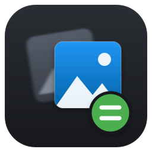
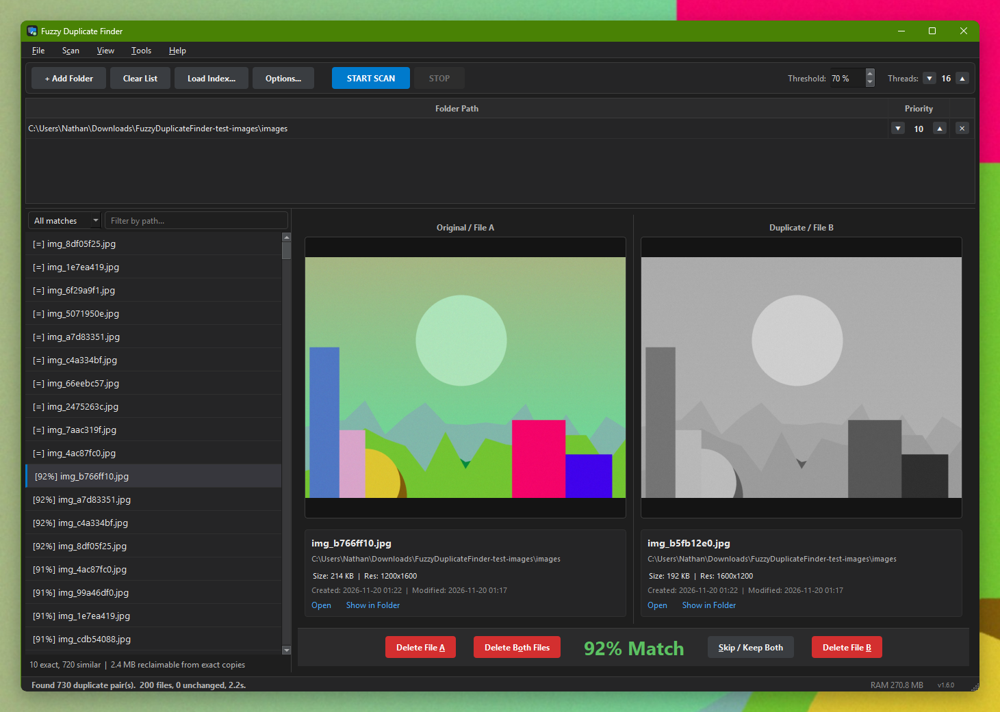

<p align="center">
  
</p>

# Fuzzy Duplicate Finder

Fuzzy Duplicate Finder finds exact copies and near-copies of your photos, videos, music and text files across one or more folders, shows them side by side, and lets you send the extras to the Trash. It is for anyone cleaning up a photo library, a music collection or a pile of backups on Linux, Windows or macOS.



## Features

- Exact duplicates of any file, found by MD5. Only files that share a size and a head/tail hash are read in full, so most of a library is never read end to end.
- Similar images (perceptual hash, EXIF rotation applied), similar videos (four-frame montage hash plus duration), similar audio (chroma fingerprint plus duration, so re-encodes at other bitrates and formats match) and similar text (SimHash over the content).
- A similarity score for every pair, with an adjustable threshold. Re-match with a new threshold without rescanning.
- Incremental scans. Each set of folders gets its own saved index, and unchanged files are never re-read. The index can live in the app's data folder, inside the scanned folder (so an encrypted disk's file paths stay on that disk), in a folder you choose, or wherever you say each time.
- Side-by-side previews that load in the background, including the first lines of text files.
- Delete A, delete B, delete both or skip, with keyboard shortcuts. Everything goes to the Trash or Recycle Bin.
- Auto-prune for exact duplicates, keeping the copy in your highest-priority folder, with a full list of what goes and what stays before anything moves.
- Resource watchdog: pauses the scan when free memory runs low, stops it before the system runs out, and names any file that is hanging a decoder.
- Filters: skip hidden files, exclude folders by name or pattern, set a minimum size, pick which kinds of files to compare.
- Results filter and search, CSV and JSON export.
- A command line mode for scripted or headless scans.
- Light and dark themes, switched with the sun/moon button in the bottom-right corner, plus System, which follows your desktop.

## Supported file types

| Kind | Extensions | Compared by |
|------|-----------|-------------|
| Images | `.jpg` `.jpeg` `.png` `.bmp` `.gif` `.webp` `.tiff` `.tif` `.psd`, plus `.avif` `.heic` `.heif` `.jxl` `.jp2` when your Pillow build can read them | pHash |
| Video | `.mp4` `.avi` `.mkv` `.mov` `.wmv` `.flv` `.m4v` `.webm` `.ts` `.mts` `.m2ts` `.3gp` `.mpg` `.mpeg` `.vob` | pHash of four frames, duration |
| Audio | `.mp3` `.wav` `.flac` `.ogg` `.oga` `.opus` `.aiff` `.aif` `.m4a` `.aac` `.wma` | chroma fingerprint, duration |
| Text and code | `.txt` `.md` `.rst` `.py` `.js` `.json` `.html` `.css` `.c` `.h` `.cpp` `.java` `.rs` `.go` `.sh` `.xml` `.yml` `.toml` `.ini` `.csv` `.log` `.srt` and more | SimHash |
| Everything else | any, when "exact duplicates of every other file type" is on | MD5 only |

`.m4a`, `.aac` and `.wma` are decoded through `ffmpeg`, so they need `ffmpeg` on your PATH. Most Linux distros have it in their repos. Without it those files are still exact-matched, just not compared by sound.

## Install

### Linux (AppImage)

Prerequisites: a desktop from roughly 2022 or newer (glibc 2.35+).

1. Download `FuzzyDuplicateFinder-<version>-x86_64.AppImage` from the [Releases page](../../releases/latest).
2. Make it executable: `chmod +x FuzzyDuplicateFinder-*-x86_64.AppImage`
3. Run it: `./FuzzyDuplicateFinder-*-x86_64.AppImage`

3.5. Optional, for a menu entry and the right taskbar icon on Wayland: `tools/install_linux_desktop_entry.sh /path/to/the.AppImage`. It installs under `~/.local/share` for your user only, and `--uninstall` removes it. Or use AppImageLauncher or Gear Lever, or whichever AppImage manager you prefer.

### Windows

1. Download `FuzzyDuplicateFinder-<version>-windows-x64.exe` from the [Releases page](../../releases/latest).
2. Run it. It is a single portable EXE with nothing to install. It is not code-signed, so SmartScreen may ask you to confirm the first time.

Upgrading from 1.6.0: if you pinned 1.6.0 to the taskbar, unpin it and pin 1.7.0 once. 1.7.0 gives itself a fixed taskbar identity, which is what fixed the missing taskbar icon, and an old pin shows up as a separate button.

### macOS

1. Download `FuzzyDuplicateFinder-<version>-macos-arm64.zip` from the [Releases page](../../releases/latest) and unzip it.
2. The app is not signed or notarized, so right-click it and choose Open the first time, or run `xattr -dr com.apple.quarantine FuzzyDuplicateFinder.app`.

### From source

Prerequisites: Python 3.10 or newer, and `ffmpeg` if you want `.m4a`/`.aac`/`.wma` audio compared.

1. `git clone https://github.com/MZGSZM/FuzzyDuplicateFinder`
2. `cd FuzzyDuplicateFinder`
3. `python -m venv venv && . venv/bin/activate` (on Windows, `venv\Scripts\activate`)
4. `pip install -r requirements.txt`
5. `python main.py`

## Using it

### The basic loop

1. Click **+ Add Folder**, or drag folders onto the window. Add as many as you like.
2. Click **START SCAN** (F5). It finds files, fingerprints them, then verifies exact duplicates and matches similar ones. The status bar shows progress and an ETA.
3. Pick a pair on the left. Both files load side by side with size, resolution, duration and dates.
4. **Delete File A**, **Delete File B**, **Delete Both Files**, or **Skip / Keep Both**. Deleted files go to the Trash, every other pair that mentioned them disappears, and the index forgets them.

### Keyboard

| Key | Action |
|-----|--------|
| Ctrl+N | Add folder |
| Ctrl+O | Load index |
| F5 | Start scan |
| F6 | Re-match without scanning |
| Esc | Stop |
| Up / Down | Previous / next pair |
| Space or Alt+S | Skip to the next pair |
| Alt+A / Alt+B | Delete file A / file B |
| Alt+O | Delete both |
| Ctrl+E | Export results |
| Ctrl+, | Scan options |
| Ctrl+Shift+L | Switch between light and dark |

### Threshold

The **Threshold** box sets the lowest score a similar pair needs to be listed. 70% is the default. Lower it to catch heavier edits, raise it if you see false matches. Changing it does nothing until you re-match: click **Re-match** next to the box, or press F6. It reuses the index and takes seconds. The button lights up when the threshold differs from the one the listed results came from.

### Scan options

**Options...** (Ctrl+,) controls:

- Which kinds of files are compared. Turning off a kind you do not care about skips its decoding entirely, which matters most for audio and video.
- Exact matching of every other file type: archives, documents, disk images.
- Skipping hidden files and folders (on by default), an exclude list (`node_modules`, `.git`, trash folders and similar by default), and a minimum file size. Empty files are always skipped, since every empty file is "identical" to every other.
- Background CPU priority for scans, the memory watchdog, and how long a file can take before it gets flagged.
- Whether to confirm before each delete. Turn it off for fast review sessions.
- Where indexes are kept. See "The index" below.

### Theme

The sun or moon at the bottom-right corner, next to the version number, shows the current theme. Click it to switch between light and dark (Ctrl+Shift+L does the same). Right-click it for Light, Dark, or Follow system, which tracks your desktop's setting and is the default.

### The index

Every scan writes a small database for its set of folders. Scanning the same folders again only reads new and changed files, so a rescan of an untouched library takes seconds. Where that database goes is set under **Index > Index Location** (also in Options):

| Setting | Where the index goes | File name |
|---------|----------------------|-----------|
| App data folder (default) | the `indexes` folder listed below | `index-<id>.db` |
| Inside the scanned folder | the first folder in the list | `.fdf-index-<id>.db` |
| A folder I choose | that folder | `fdf-index-<id>.db` |
| Ask each time | wherever you pick, asked once per set of folders per session | your choice |

The app data folder is:

- Linux: `~/.local/share/FuzzyDuplicateFinder/indexes/`
- Windows: `%LOCALAPPDATA%\FuzzyDuplicateFinder\indexes\`
- macOS: `~/Library/Application Support/FuzzyDuplicateFinder/indexes/`

Why keep it inside the scanned folder? Because an index lists the name and full path of every file it covers. If you scan an encrypted disk with the default setting, that list ends up on your system disk, which may not be encrypted. Inside the scanned folder, the list stays on the disk it describes. A few rules follow from that:

- If the folders are on different disks, the first scan asks which folder holds the index. It lists paths from all of them, so pick the disk those paths are safe on. Later scans find it on their own.
- If the index location cannot be written to (a read-only share, a disc, permissions), the scan does not start. You get the choice of another location for this set of folders, or Cancel. NOTHING FALLS BACK TO THE APP DATA FOLDER ON ITS OWN, in any setting.
- The scan log goes beside the index, in a `.fdf-logs` folder (`fdf-logs` for a folder you chose), instead of the app's log folder. It is a complete log with full paths, just stored with the data it describes.
- Paths in the index are absolute. If the disk mounts somewhere else next time, the next scan builds a new index beside the old one, which you can delete.

The folder list is not saved between sessions in any setting, so no folder names stay behind in the app's settings. To pick up where you left off, either add the same folders again, which finds the same index, or use **Index > Load Index...**, which brings back the folders and their priorities.

Changing the setting does not move existing indexes. **Index > Load Index...** (Ctrl+O) opens any index by hand, including ones made by version 1.5 and earlier. Old indexes are upgraded in place; their video and audio fingerprints are recomputed on the next scan.

**Index > Delete Saved Index for These Folders** throws the index away, with its scan log. **Index > Rebuild Index From Scratch** throws it away and rescans. **Index > Open Index Folder** opens the folder the current index is in.

### Folder priorities and auto-prune

Each folder has a priority, 10 by default, set with the arrows in the folder table.

**Results > Auto-Prune Exact Duplicates** keeps one copy of every exact duplicate group and moves the rest to the Trash. The copy kept is the one in the highest-priority folder. Ties go to the shortest path, then alphabetical order, so the result is the same every time. With nested folders, the most specific folder's priority counts. The confirmation dialog's **Show Details** lists every file that will move and the copy it is a duplicate of.

Auto-prune never touches similar-but-not-identical files. Those always need a look from you.

### Resource watchdog

While a scan runs, the status bar shows the app's memory use, CPU use and the system's free memory.

- When free memory drops below about 8% of RAM (at least 512 MB), the scan pauses before starting new files and resumes once memory recovers.
- If free memory stays below about 4% (at least 256 MB) for five seconds, the scan stops with a message instead of letting the system start killing programs.
- If one file takes longer than the limit in Options (120 seconds by default), its name shows in the status bar and it lands in the **Files With Issues** list. A corrupt video can hang a decoder; the rest of the scan carries on around it.

### Files with issues

Files that could not be fingerprinted (corrupt, unreadable, silent audio, a format without a decoder) show up behind the red **Files With Issues** link with the reason for each. They are still exact-matched where they could be read. The list can be copied or exported.

### Command line

The same engine runs without the GUI. Results print as tab-separated pairs, or go to CSV or JSON. Nothing is ever deleted from the command line.

```
FuzzyDuplicateFinder scan ~/Pictures /mnt/backup/Pictures --csv dupes.csv
FuzzyDuplicateFinder scan ~/Music --kinds audio --threshold 80
FuzzyDuplicateFinder scan /srv/share --exact-only --json report.json
FuzzyDuplicateFinder scan --help
```

From source it is `python main.py scan ...`. The CLI follows the Index Location set in the GUI, so either one makes the other's next scan incremental. These override it for one run:

| Option | Index goes |
|--------|-----------|
| `--db FILE` | in that file |
| `--index-appdata` | in the app data folder |
| `--index-in-folder` | inside the scanned folder |
| `--index-dir DIR` | in DIR |

Where the GUI would ask something (Ask each time, folders on different disks, a location that cannot be written to), the CLI asks on the terminal. Run from a script with no terminal, it exits with code 2 and names the options above instead of waiting or guessing. It also exits with code 2 if a folder does not exist.

On Windows the EXE is a GUI program with no console, so the CLI only writes its `--csv`/`--json` files there, and cannot ask questions; run it from source if you want the terminal output.

The app log is in the `logs` folder next to `indexes`. Scans whose index lives anywhere else log beside that index instead. **Help > Open Log Folder** opens the scan log folder for the current folders when they have one, otherwise the app log folder.

## How scoring works

Similar files are only ever compared within their own kind: images with images, videos with videos, and so on. For each candidate pair:

| Signal | Weight | Method |
|--------|--------|--------|
| Content | 50 | pHash, chroma fingerprint or SimHash distance |
| Filename | 20 | SequenceMatcher ratio |
| Duration | 15 | video and audio only, when both are known |
| Size | 10 | used instead of duration for images and text |
| Extension | 5 | same extension or not |

The score is the weighted average of the signals that apply, so the weights are relative, not percentages. For video and audio, duration replaces size, because a re-encode changes the size a lot and the duration not at all.

Finding candidates is a Hamming-distance search over fixed-width fingerprints, vectorised with numpy across threads. It skips any pair whose content distance is too large to reach the threshold even with every other signal perfect, so the shortcut never drops a real match. Copies that are already exact duplicates are collapsed to one before the similar pass, so a near-copy is listed once and not once per exact copy. Hardlinks to the same file are one file and are never listed.

## Development

```
pip install -r requirements-dev.txt
python -m pytest
ruff check .
shellcheck .github/scripts/*.sh packaging/appimage/AppRun tools/*.sh
```

The GUI tests run headless through Qt's offscreen platform. CI runs all of this on Linux, Windows and macOS for every push to `main` and every pull request.

### Test images

`test-images/` holds 200 images for checking matching by hand: what the app catches, what it misses, and where the threshold falls. The automated tests use small generated files. This set is for seeing results in the GUI the way a user would.

There are 10 groups of 20. Each group starts from one generated scene, then goes from a byte-identical copy through re-saves, format changes, resizing, brightness, blur, noise, grayscale, crops, a caption bar, a small rotation and a mirror image, down to a completely different scene. File names are random so they cannot hint at which files belong together. `manifest.csv` says which group each file is in, what was done to it, and the score the app gave it against the group's original when the set was made.

1. Add the `test-images/images` folder and start a scan. Add `images`, not its parent, so the manifest and script stay out of the scan.
2. Compare the results against `manifest.csv`. Sorting by `group` then `step` makes it easy to read.

At the default 70% threshold, 1.6.0 finds the byte copy, re-saves, format changes, resize, EXIF rotation, brightness, blur and grayscale in essentially every group. It finds the heaviest re-save, the contrast change and the heavy noise in most groups. Crops, the caption bar, rotation, mirroring and the different scene are never matched. There are no false matches between groups. Run the set again after any change to fingerprints or scoring, and compare against the manifest to see what moved. The folder's own README has the full list of variants and explains every manifest column. Its `generate_test_images.py` rebuilds the set, or refreshes the manifest's scores against the current code.

### Building

To build locally: `pyinstaller --noconfirm FuzzyDuplicateFinder.spec`. On Linux, `bash .github/scripts/build-appimage.sh 1.7.0` then wraps `dist/FuzzyDuplicateFinder/` in an AppImage.

## Making a release

Releases are built by GitHub Actions from a tag you create first. Nothing builds on a push or a tag push.

1. Bump `VERSION` in `fdf/_version.py` and add an entry to `changes.md`, then commit. (The workflow stamps the tag's version into the build anyway, but this keeps source runs honest and the changelog entry becomes the release summary.)
2. On GitHub, go to **Releases** and click **Draft a new release**.
3. Under **Choose a tag**, type the new tag, like `v1.7.0`, and pick **Create new tag on publish**.
4. Write a title and any notes you want, then **Publish release**.
5. Go to **Actions** and click **Build and release** in the list on the left.
6. Click **Run workflow**, pick the tag you just made under **Use workflow from** (switch to the Tags tab in that menu), and click **Run workflow**.
7. Wait for it to finish. It runs the full test suite, builds the Linux AppImage, Windows EXE and macOS zip from that tag, and attaches them plus `SHA256SUMS.txt` to the release.

It also adds a generated "Changes since" section to the release notes: your `changes.md` entry, the commits since the previous tag grouped into Added, Changed, Fixed and Removed, merged pull requests, and the list of files touched. Your own notes above it are kept. Running the workflow again on the same tag replaces the files and the generated section; it does not duplicate them.

If you run it on a branch instead of a tag, or on a tag with no release yet, it stops right away and says which.

## Project layout

```
FuzzyDuplicateFinder/
├── main.py                       entry point: GUI, or CLI when given `scan`
├── fdf/
│   ├── exts.py                   file type tables, the only place they live
│   ├── fingerprints.py           exact, quick, image, video, audio and text fingerprints
│   ├── index.py                  sqlite index and schema upgrades
│   ├── scanner.py                walking, filters, the three hashing passes
│   ├── matcher.py                exact groups, Hamming search, scoring
│   ├── pipeline.py               scan then match, shared by GUI and CLI
│   ├── watchdog.py               memory/CPU watchdog, stalled-file tracking
│   ├── cli.py                    command line mode
│   ├── export.py                 CSV and JSON
│   ├── paths.py                  per-user data, cache and index locations, index location modes
│   ├── logs.py                   app log, and scan logs beside indexes outside app data
│   ├── gui.py                    main window
│   ├── preview.py                background preview loading
│   ├── dialogs.py                options and issues dialogs
│   ├── settings.py               persisted settings
│   ├── theme.py                  light/dark tokens, stylesheet, system detection
│   └── buildinfo.py              Windows version resource values, used by the build only
├── tests/                        pytest suite
├── test-images/
│   ├── images/                   200 graded test images
│   ├── manifest.csv              what each image is, and its score when made
│   └── generate_test_images.py   rebuilds the set
├── assets/                       icons and the desktop entry
├── packaging/appimage/AppRun     AppImage entry point
├── tools/                        icon builder, Linux desktop entry installer
├── .github/workflows/ci.yml      lint and tests
├── .github/workflows/build.yaml   tag builds and release upload
├── .github/scripts/              AppImage packaging, release notes
├── FuzzyDuplicateFinder.spec     PyInstaller build
├── README.md
├── maintenance.md
└── changes.md
```

The icon SVGs in `assets/` are the source of truth. After editing one, regenerate the PNG, ICO and ICNS files with `pip install cairosvg Pillow` and `python tools/build_icons.py`.

## License

See [LICENSE](LICENSE).
